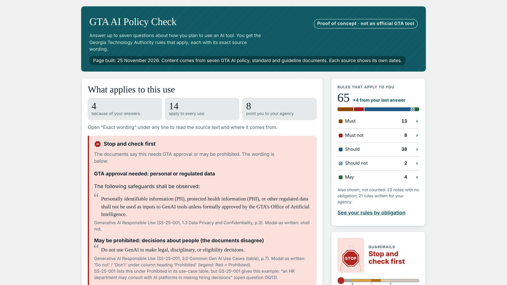
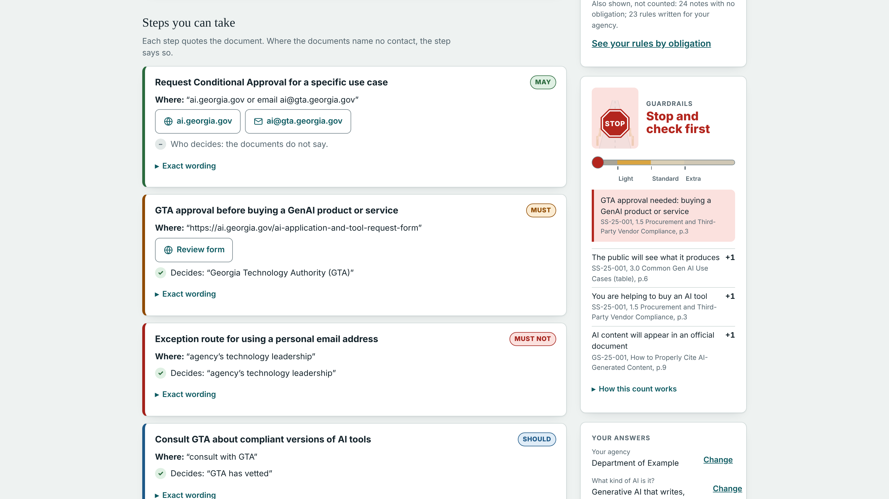
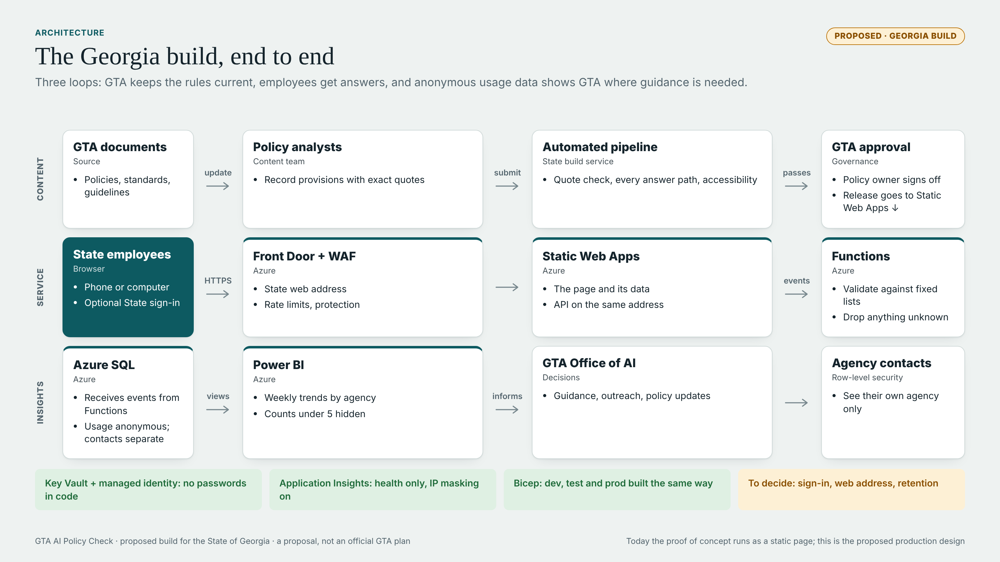
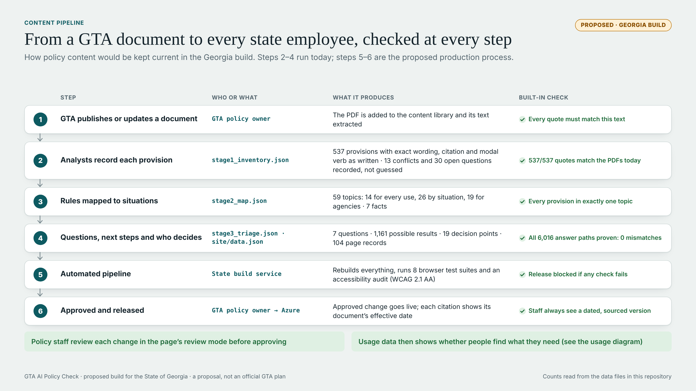

```
   ____ _____  _        _    ___
  / ___|_   _|/ \      / \  |_ _|
 | |  _  | | / _ \    / _ \  | |
 | |_| | | |/ ___ \  / ___ \ | |
  \____| |_/_/   \_\/_/   \_\___|
     p o l i c y   c h e c k
```

# GTA AI Policy Check

Answer up to seven questions about how you plan to use an AI tool, and see which Georgia Technology Authority (GTA) AI policies, standards and guidelines apply. You get each rule's exact wording and source, the obligations that apply to you, any approval you need first, and where to go next.

**Status: proof of concept.** This is not an official GTA tool, and it is not legal advice.
- **Live demo:** <https://jbloewencolon.github.io/GTA-PSG-Nav/> (published from `main` by GitHub Pages; see [Publish the demo](#publish-the-demo-github-pages))
- **Content:** 537 provisions quoted from 7 GTA documents. Every quote is checked word for word against the source PDFs.
- **Readings that need GTA's confirmation:** listed in [docs/questions_for_gta.md](docs/questions_for_gta.md)

## Screenshots

| Your rules and guardrails, as you answer | A red stop when GTA approval is required |
|---|---|
|  |  |
| **An amber Check first for other AI** | **Next steps, with who decides** |
|  |  |

More in [`docs/images/`](docs/images/): the title screen, the question flow, exact wording with citations, results grouped by obligation, dark mode and a phone view. Screenshots are 3200×1800 (phone: 1170×2532), for slides as well as this page.

## Features

The tool is one static page (`site/index.html`) that loads `site/data.json` in the browser. There is no server-side code, no sign-in, and no third-party request.

- **Title screen:** your agency (required) and work email (optional), then Start. In this proof of concept both stay in your browser, to fill in the form next time, and are never sent anywhere. "Forget my details" clears them. A header pill says it is a proof of concept, and the page asks search engines not to index it.
- **Questions:** up to seven plain-language questions, starting with the kind of AI. Every question has a "Not sure" answer, which is treated as if it applies, to be safe. The second question (what you're using it for) accepts several answers; the result is everything any chosen task triggers. A "Your answers" panel lets you change any answer, and Start over (in the panel and at the end of every result page, including "It does not use AI") clears your answers and returns to the first question.
- **Rules that apply to you:** a live count at the top of the side panel. It starts at 0, fills in on your first answer, and then says what each answer changed ("+7 from your last answer", "No new rules from your last answer"). A bar and legend split it into Must, Must not, Should, Should not and May; each row opens the results grouped by obligation at that section, with the same count (opened before the last question, the page says the rules cover your answers so far). Notes with no obligation, and rules written for your agency, are listed but not counted; in the grouped view, agency rules have their own section.
- **Guardrails:** a road picture whose posts rise with risk factors in what you described: personal or sensitive information (2), a decision about a person (2), something the public sees or uses (1), buying or building an AI tool (1), AI content in an official document (1), and legal analysis or AI note-taking in meetings (1). Levels: Baseline rules only (0), Light (1–2), Standard (3–4), Extra (5+). Each reason cites its provision. These values are the tool's own, pending GTA sign-off.
- **Stop and Check first signs:**
  - **Red stop:** the documents require GTA approval, or may prohibit the use. With generative AI, this covers personal or regulated data (SS-25-001 1.3), buying a GenAI product (SS-25-001 1.5) and decisions about people (SS-25-001 3.0; GS-25-001 disagrees, OQ13).
  - **Amber Check first:** a review or authorization is required first. With other AI, this covers buying (PS-23-001) and personal data (SS-23-002 §6).

  The source wording appears at the top of the results.
- **Results:** shown by topic, or grouped by obligation, by document type or by document. Each line opens to the exact quote, with the document, identifier, section, page, modal verb as written, effective date and, where known, the date the copy was captured. The page also flags where the documents disagree or leave something open.
- **Next steps:** what you can do, with any contact or link the documents give and who decides; decisions written for agencies sit in a closed "For your agency" panel.
- **Review mode** (the switch at the bottom of Next steps, or `#review` in the address): the full view for policy staff, with the modal verb as written, analyst notes, unresolved references and conflicts.
- **Accessible and printable:** keyboard and screen-reader support, automated WCAG 2.1 AA checks in CI (contrast, target size, reflow), light and dark themes, reduced motion, phone layouts, and a print style that expands every quotation.

## The proposed Georgia build

The diagrams show how the tool **would be built for the State of Georgia**: hosted in the State's Microsoft Azure environment, with GTA approving each content release, and anonymous usage data in Power BI. It is a proposal; nothing here describes a system GTA runs. The full plan is [docs/backend_plan.md](docs/backend_plan.md).





| Diagram | For |
|---|---|
| [Simplified, with logos](docs/images/16-tech-stack-simple.png) | Non-expert audiences |
| [Tech stack, layer by layer](docs/images/13-tech-stack.png) | Today / proposed / State options |
| [The data Georgia would maintain and collect](docs/images/11-data-at-a-glance.png) | Content statistics and planned usage metrics |
| [What the data looks like](docs/images/12-data-records.png) | A provision record and a proposed usage event |
| [How usage data flows](docs/images/15-architecture-azure.png) | Privacy controls in detail |

The counts in the diagrams are read from the data files, so they stay current when the diagrams are regenerated (see [Regenerate the images](#regenerate-the-images)).

## Quick start

Requirements: Python 3.11 or later (run on 3.11–3.13) and a modern browser. The pipeline and the page need no packages.

```bash
git clone https://github.com/jbloewencolon/GTA-PSG-Nav.git
```

```bash
cd GTA-PSG-Nav
```

```bash
python3 -m http.server 8765 --directory site
```

Then open <http://localhost:8765/>. The server prints `Serving HTTP on 0.0.0.0 port 8765 …` and runs until you press Ctrl+C.

## Working on it

### Rebuild the data

`data/stage1_inventory.json` is the input. Run these from the repository root, in order. With the committed inventory, each step reproduces the committed files byte for byte (CI fails otherwise).

```bash
python3 scripts/partA.py data/stage1_inventory.json data/stage2_map.json
```
Last line: `pointers 12 conflicts 13 unres 31 oq 30`

```bash
python3 scripts/partB.py data/stage2_map.json data/stage3_triage.json 8
```
The last argument is the longest path allowed, in questions. It prints a JSON report (`"number_of_paths": 6016`, `"longest_path_questions": 7`, …) and ends with `mism 0 redundant 0 bad_skips 0`. It takes a few seconds.

```bash
python3 scripts/render_md.py data/stage3_triage.json data/stage3_triage.md
```
Output: `1532 lines`

```bash
python3 scripts/decision_rights.py data/stage1_inventory.json data/stage2_map.json data/decision_rights.json data/decision_rights.md
```
First line: `{"decisions": 19, "documents_disagree": 2, "named": 12, "not_named": 5, "employee_level": 9, "agency_level": 10, "not_reached_by_any_question": 4}`

```bash
NAV_UPDATED=2026-11-25 python3 scripts/gen_site.py data/stage1_inventory.json data/stage2_map.json data/stage3_triage.json site data/decision_rights.json
```
Output: `104 records 350741 bytes`. `NAV_UPDATED` sets the "Page built" date on the page; without it the script uses today's date.

What each script does:

| Script | Reads → writes | Built-in check |
|---|---|---|
| `partA.py` | inventory → `data/stage2_map.json` (topics, facts, agency pointers) | every provision in exactly one topic |
| `partB.py` | map → `data/stage3_triage.json` (questions and outcomes) | every answer path against the map |
| `render_md.py` | question tree → `data/stage3_triage.md` | — |
| `decision_rights.py` | inventory + map → `data/decision_rights.json` / `.md` | every role quoted verbatim |
| `gen_site.py` | all of the above → `site/data.json`, plus guardrail factors and signs | step contacts, links and sign provisions against the source |

### Check the quotes against the source PDFs

```bash
python3 scripts/verify_sources.py data/stage1_inventory.json data/source_text
```

Checks every excerpt and lead-in word for word against `data/source_text/<doc_id>.txt`. It ignores only print headers and footers, line breaks, and line breaks after a hyphen or dash, and exits with status 1 if anything is missing. All 537 provisions currently pass.

The source PDFs are in `data/Instruments_GTA Policies/`. To add or refresh a document, run `pdftotext -layout <file>.pdf data/source_text/<doc_id>.txt` (poppler-utils). A document may have a second extraction named `<doc_id>.<mode>.txt`: `SS-25-001.raw.txt` comes from `pdftotext -raw`, which keeps the use-case table's cells whole. An excerpt passes if it appears in any extraction of its document.

### Run the tests

The tests need Playwright for Python and Chrome or Chromium.

```bash
python3 -m venv .venv
```

```bash
. .venv/bin/activate
```

```bash
python3 -m pip install -r requirements-dev.txt
```

With the page served on port 8765 (see Quick start), run the suites from the repository root. They use `/usr/bin/google-chrome` unless `CHROME_PATH` is set.

```bash
for t in tests/test_*.py; do python3 "$t" || echo "FAILED: $t"; done
```

Each suite prints one line per route ending in `PASS` or `FAIL`, and exits with status 1 on any failure.

| Suite | Checks |
|---|---|
| `test_intro.py` | Title screen: validation and focus, saving, "Forget my details", Start over, blocked storage, and that no request leaves the site |
| `test_obligations.py` | "Rules that apply to you": 0 before answering, recalculated from the data after every answer, each legend row lands on a matching section, and Start over (4 routes) |
| `test_score.py` | Guardrails and signs against an independent calculation over 53,656 routes, then 11 routes in the page |
| `test_multi.py` | Several tasks = the union of single tasks, over 125,280 combinations, then 5 routes in the page |
| `test_decisions.py` | Who decides, in review mode (7 routes) |
| `test_employee.py` | The employee view of Next steps (7 routes) |
| `test_steps.py`, `test_v2.py`, `test_views.py` | Next steps, result cards and the grouped views |

```bash
python3 tests/a11y_audit.py report.json
```

Writes accessibility findings to `report.json`: contrast, target sizes, headings, live regions and reflow at 320px and at 200% zoom, in light and dark. It prints nothing.

### Continuous integration

`.github/workflows/ci.yml` runs on every push and pull request:
1. Rebuilds the data with the committed "Page built" date, and fails if any file changes.
2. Runs the quote check.
3. Runs every browser test suite.
4. Fails on accessibility findings for contrast, target size or reflow.

### Publish the demo (GitHub Pages)

`.github/workflows/pages.yml` publishes `site/` whenever `main` changes. One-time setup: in the repository, go to Settings → Pages → Build and deployment → Source and choose **GitHub Actions**. Then the "Deploy to GitHub Pages" run in the Actions tab shows the address. After a deploy, a hard refresh (Ctrl+Shift+R) clears a cached old version.

### Regenerate the images

The page screenshots (00–09) need the page served on port 8765. The diagrams (10–16) are built from the data files. Both use Playwright, so set `CHROME_PATH` if Chrome isn't at `/usr/bin/google-chrome`.

```bash
python3 docs/diagrams/screenshots.py docs/images
```

```bash
python3 docs/diagrams/build.py /tmp/diagrams
```

```bash
python3 docs/diagrams/render.py /tmp/diagrams docs/images
```

## Project structure

```
GTA-PSG-Nav/
├── .github/workflows/            ci.yml (build + tests), pages.yml (publish)
├── AUDIT.md                      audit of the project (2026-11-26)
├── CLAUDE.md                     notes for AI coding assistants
├── CONTRIBUTING.md               content rules and how to contribute
├── tasks.md / completed_tasks.md open and finished work
├── requirements-dev.txt          playwright (tests and images only)
├── data/
│   ├── stage1_inventory.json     537 provisions (pipeline input)
│   ├── stage2_map.json           topics, facts, agency pointers
│   ├── stage3_triage.json/.md    question tree and outcomes
│   ├── decision_rights.json/.md  who decides what
│   ├── Instruments_GTA Policies/ the 7 source PDFs
│   └── source_text/              text extracted from the PDFs
├── docs/
│   ├── backend_plan.md           proposed Azure backend for usage data
│   ├── questions_for_gta.md      readings that need GTA confirmation
│   ├── diagrams/                 image generators; icons/ holds logos (see NOTICE.md)
│   └── images/                   screenshots and diagrams
├── scripts/                      the pipeline and verify_sources.py
├── site/
│   ├── index.html                the page
│   └── data.json                 what it loads
└── tests/                        9 browser test suites and a11y_audit.py
```

The step that produced `data/stage1_inventory.json` from the PDFs is not in the repository. Wherever a provision's grouping (must, should, …) isn't its literal verb, the inventory records why in `classification_basis`.

## Project documents

- [AUDIT.md](AUDIT.md): the audit that started this work (policy, data, scoring, UX, accessibility and engineering), with status notes
- [docs/questions_for_gta.md](docs/questions_for_gta.md): questions for GTA, including which documents are current, the 2025 links, guardrail values, sign wording and modal readings
- [docs/backend_plan.md](docs/backend_plan.md): proposed Azure backend for usage data and trends
- [tasks.md](tasks.md) and [completed_tasks.md](completed_tasks.md): open and finished work

## Contributing

See [CONTRIBUTING.md](CONTRIBUTING.md). The content rules matter most: quote exactly, keep modal verbs as written, and record conflicts and open questions instead of choosing an answer.

## License

The code is released under the MIT License; see [LICENSE](LICENSE). The policy text in `data/`, `site/data.json` and `data/source_text/`, and the PDFs in `data/Instruments_GTA Policies/`, come from GTA documents. Check their terms before reusing them. Logos in `docs/diagrams/icons/` are trademarks of their owners (see its NOTICE.md).
