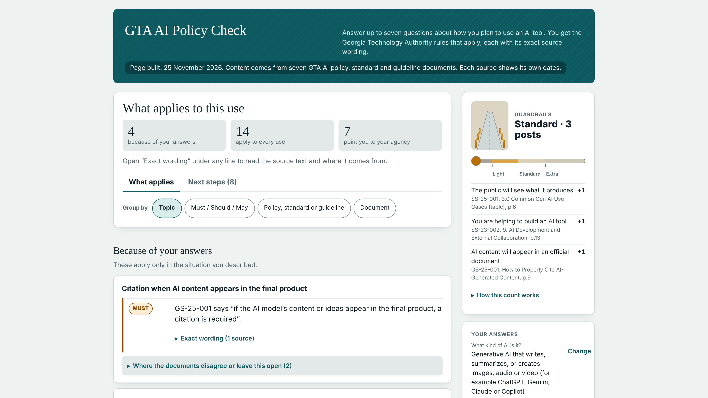
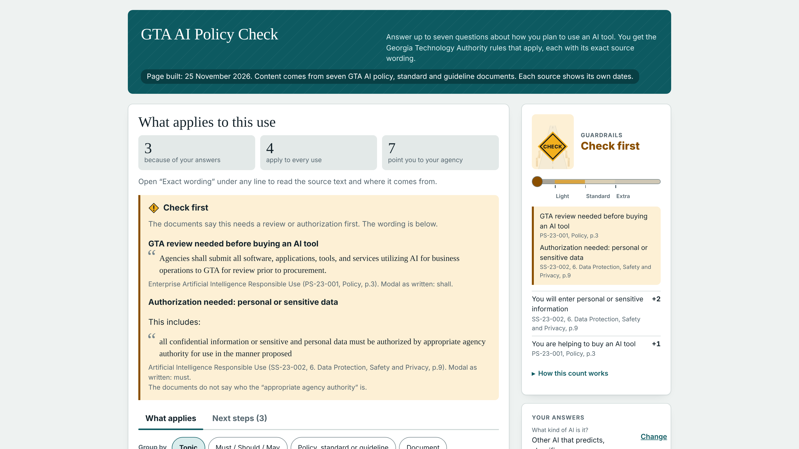

```
   ____ _____  _        _    ___
  / ___|_   _|/ \      / \  |_ _|
 | |  _  | | / _ \    / _ \  | |
 | |_| | | |/ ___ \  / ___ \ | |
  \____| |_/_/   \_\/_/   \_\___|
     p o l i c y   c h e c k
```

# GTA AI Policy Check

Answer a few questions and see which Georgia Technology Authority (GTA) AI policies, standards and guidelines apply, with their exact source wording.

## Screenshots

| Guardrails rise with what you describe | A red stop when GTA approval is required |
|---|---|
|  |  |
| **An amber Check first for other AI** | **Next steps, with who decides** |
|  |  |

More in [`docs/images/`](docs/images/): the question flow, exact source wording with citations, results grouped by obligation, dark mode, and a phone view. All are 3200×1800 (phone: 1170×2532).

## Features

**The navigator page** (`site/`) is a single static HTML page that reads `site/data.json` in the browser. It needs no server-side code.
- **Questions:** up to seven plain-language questions, starting with what kind of AI is used. Every question has a "Not sure" answer. A "Your answers" panel lets you change any answer.
- **Several tasks at once:** the second question (what the tool is used for) accepts several answers. The results are everything any chosen task triggers on its own, and follow-up questions appear if any chosen task needs them. Choosing "Not sure" clears the other choices.
- **Results:** only the provisions that apply, shown by topic or grouped by modal verb (must, must not, should, should not, may), by document type (policy, standard, guideline) or by document.
- **Exact wording:** each line opens to the quoted source text with the document title, identifier, section, page, the modal verb as written, the document's effective date and, where known, the date the copy used was captured. The page also flags where the documents disagree or leave something open. In the grouped views, the citation sits in a collapsed "Source" line under each quote.
- **Next steps tab:**
  - steps the documents name, with any contact given in the source and a "Decides" line naming who makes the call;
  - decisions with no step card, as one-line rows;
  - items written for agencies, in one closed "For your agency" panel.
- **Review details switch:** at the bottom of Next steps (or open the page with `#review`). It restores the full view for policy staff: the modal verb as written, analyst notes, unresolved references and the panels on where the documents disagree.
- **Guardrails:** a road picture whose guardrail posts rise with what you described, not with how many rules apply. Each of these adds posts once: personal or sensitive information 2, a decision about a person 2, something the public sees or interacts with 1, buying or building an AI tool 1, AI content in an official document 1, legal analysis or AI note-taking in meetings 1. A Not sure answer counts as yes. Levels: Baseline rules only (0), Light (1-2), Standard (3-4), Extra (5 or more). The panel lists each reason with the provision it rests on. The values are this tool's, not GTA's.
- **Stop and Check first signs:** replace the guardrails, with the source wording at the top of the results. A red stop sign shows when the documents require GTA approval for what you described with generative AI (personal or regulated data, SS-25-001 1.3; buying a GenAI product or service, SS-25-001 1.5) or may prohibit it (decisions about people, SS-25-001 3.0 table; GS-25-001 disagrees, OQ13). An amber Check first sign shows when a review or authorization is required first for other AI (buying, PS-23-001; personal or sensitive data, SS-23-002 6). A Not sure answer to those questions also shows them.
- **Explanations on request:** each question's help text, the note on how the count works and the longer result notes are collapsed under links such as "About this question".
- **Display:** light and dark themes, reduced-motion support, and a print style sheet that expands every source quotation.

**The build pipeline** (`scripts/`) uses only the Python standard library.
- `partA.py` builds the applicability map (`data/stage2_map.json`) from the provision inventory.
- `partB.py` builds the question tree (`data/stage3_triage.json`). It checks every answer path against the map and reports mismatches, redundant questions and bad skips.
- `render_md.py` renders the tree as Markdown (`data/stage3_triage.md`).
- `decision_rights.py` lists who decides what (`data/decision_rights.json`, `data/decision_rights.md`).
- `gen_site.py` assembles `site/data.json`. It checks that each step's quoted contact and link appear in the source text, and holds the guardrail factors and the stop and Check first signs.

**Browser tests** (`tests/`) click through routes with Playwright. They check results, groupings, next steps, decisions, multi-task answers, the guardrails and the signs against the data files, and run an automated accessibility check.

## Requirements

- **Pipeline:** Python 3.11 or later. It was run on 3.11, 3.12 and 3.13 and not tested on earlier versions. It has no third-party packages.
- **Navigator page:** a modern web browser. To open it locally, use any static file server; the commands below use Python's built-in one. The page uses system fonts and makes no third-party requests.
- **Tests only:**
  - Playwright for Python (`requirements-dev.txt`; pinned to Playwright 1.65.2).
  - A Chrome or Chromium executable. The tests use `/usr/bin/google-chrome` unless `CHROME_PATH` is set.
  - The navigator page served at `http://localhost:8765`.

## Installation

```bash
git clone <repository-url>
cd GTA-PSG-Nav
```

The pipeline and the page need nothing else. To run the tests, install the development dependency in a virtual environment:

```bash
python3 -m venv .venv
. .venv/bin/activate
python3 -m pip install -r requirements-dev.txt
```

## Usage

### Open the navigator

```bash
python3 -m http.server 8765 --directory site
```

Expected output (the server keeps running until you press Ctrl+C):

```
Serving HTTP on 0.0.0.0 port 8765 (http://0.0.0.0:8765/) ...
```

Then open <http://localhost:8765/> in a browser.

### Rebuild the data from the provision inventory

`data/stage1_inventory.json` is the input to the pipeline. Run the steps in order from the repository root. With the committed inventory, each step reproduces the committed output files byte for byte.

```bash
python3 scripts/partA.py data/stage1_inventory.json data/stage2_map.json
```
Last line of output: `pointers 12 conflicts 13 unres 31 oq 30`

```bash
python3 scripts/partB.py data/stage2_map.json data/stage3_triage.json 8
```
The last argument is the maximum number of questions allowed on the longest path. The command prints a JSON report (`"number_of_paths": 6016`, `"longest_path_questions": 7`, `"within_limit": true`, among others) and ends with `mism 0 redundant 0 bad_skips 0`. It takes a few seconds.

```bash
python3 scripts/render_md.py data/stage3_triage.json data/stage3_triage.md
```
Output: `1532 lines`

```bash
python3 scripts/decision_rights.py data/stage1_inventory.json data/stage2_map.json data/decision_rights.json data/decision_rights.md
```
First line of output: `{"decisions": 19, "documents_disagree": 2, "named": 12, "not_named": 5, "employee_level": 9, "agency_level": 10, "not_reached_by_any_question": 4}`

```bash
NAV_UPDATED=2026-11-25 python3 scripts/gen_site.py data/stage1_inventory.json data/stage2_map.json data/stage3_triage.json site data/decision_rights.json
```
Output: `104 records 350741 bytes`

`NAV_UPDATED` sets the "Page built" date shown on the page. Without it, the script uses today's date, and the byte count changes with the length of the date.

### Run the tests

With the server from "Open the navigator" running in another terminal:

```bash
python3 tests/test_decisions.py
```

Expected output: seven lines ending in `PASS`, for example:

```
build_legal: decisions 12 expected 12 | who-decides lines 6/6 | steps 9/9 | PASS []
```

The other test scripts work the same way. Each exits with status 1 if any check fails.
- `tests/test_employee.py`: 7 routes. Checks the employee view of Next steps, and that review-only items stay hidden.
- `tests/test_score.py`: checks the guardrail rules in the data against an independent calculation over 53,656 answer routes, and that every quoted provision is shown on that route. Then clicks 11 routes in the page, and ends with `ALL PASS`.
- `tests/test_steps.py`: 3 routes.
- `tests/test_v2.py`: 5 routes.
- `tests/test_views.py`: 6 checks.
- `tests/test_multi.py`: checks that a result with several tasks chosen is exactly the union of the single-task results. It covers 125,280 answer combinations in the data, then clicks 5 routes in the page, and ends with `ALL PASS`.

`tests/test_decisions.py` opens the page in Review mode (`#review`).

### Check the quotes against the source documents

```bash
python3 scripts/verify_sources.py data/stage1_inventory.json data/source_text
```

Checks that every quoted excerpt and lead-in appears word for word in `data/source_text/<doc_id>.txt`. It ignores only browser print headers and footers, line breaks, and line breaks after a hyphen. It exits with status 1 if an excerpt is missing, and lists documents that have no source text yet. The source PDFs are in `data/Instruments_GTA Policies/`. To add or refresh a document, extract its text with `pdftotext -layout <file>.pdf data/source_text/<doc_id>.txt` (poppler-utils). A document may also have other extractions of the same PDF, named `<doc_id>.<mode>.txt`: `SS-25-001.raw.txt` comes from `pdftotext -raw`, which keeps the use-case table's cells whole where `-layout` interleaves its columns. An excerpt passes if it appears in any extraction of its document. All 537 provisions in the 7 documents currently pass.

### Continuous integration

`.github/workflows/ci.yml` runs on every push and pull request. It rebuilds the data with the committed "Page built" date and fails if any file changes, runs the source check and every browser test, and fails on accessibility findings for contrast, target size or reflow.

`python3 tests/a11y_audit.py report.json` writes accessibility findings (contrast, target sizes, headings, live regions, reflow) to `report.json`, with no console output. Screenshots from the tests go to `tests/screenshots/`.

## Project structure

```
GTA-PSG-Nav/
├── .github/workflows/ci.yml
├── CLAUDE.md
├── CONTRIBUTING.md
├── LICENSE
├── README.md
├── requirements-dev.txt
├── data/
│   ├── stage1_inventory.json     provision inventory (pipeline input)
│   ├── stage2_map.json           applicability map
│   ├── stage3_triage.json        question tree and outcomes
│   ├── stage3_triage.md          tree rendered as Markdown
│   ├── decision_rights.json      who decides what
│   ├── decision_rights.md
│   ├── Instruments_GTA Policies/ the 7 source PDFs
│   └── source_text/
│       └── <doc_id>[.raw].txt    text extracted from the PDFs, checked by verify_sources.py
├── docs/
│   └── questions_for_gta.md      readings that need GTA confirmation
├── scripts/
│   ├── partA.py                  inventory -> map
│   ├── partB.py                  map -> question tree
│   ├── render_md.py              tree -> Markdown
│   ├── decision_rights.py        inventory + map -> decision rights
│   ├── gen_site.py               all of the above -> site/data.json
│   └── verify_sources.py         excerpts vs source text
├── site/
│   ├── index.html                the navigator page
│   └── data.json
└── tests/
    ├── test_decisions.py
    ├── test_employee.py
    ├── test_multi.py
    ├── test_score.py
    ├── test_steps.py
    ├── test_v2.py
    ├── test_views.py
    └── a11y_audit.py
```

This repository does not include the step that produced `data/stage1_inventory.json` from the source PDFs. Each non-literal modal reading carries a `classification_basis` in the inventory.

## Contributing

See [CONTRIBUTING.md](CONTRIBUTING.md).

## License

The code is released under the MIT License; see [LICENSE](LICENSE). The policy text quoted in `data/`, `site/data.json` and `data/source_text/`, and the PDFs in `data/Instruments_GTA Policies/`, come from GTA documents. Check the terms of those documents before reusing the quoted text.
